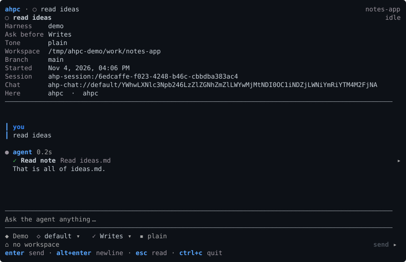
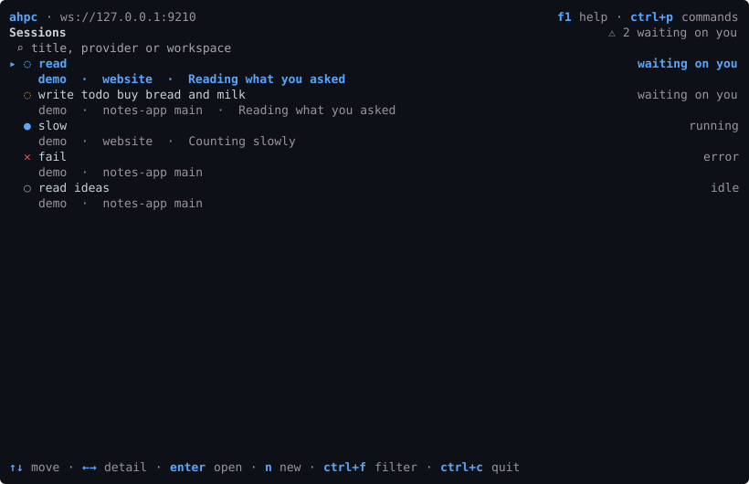
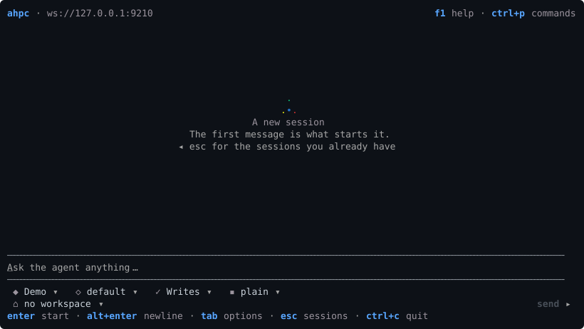

# ahpc

[](https://github.com/ahpio/ahpc/actions/workflows/ci.yml)
[](https://www.npmjs.com/package/@softov/ahpc)
[](https://ahpio.github.io/ahpc/)


A terminal client for the [Agent Host Protocol](https://microsoft.github.io/agent-host-protocol/).
It can be used as cli (commands), tui (interactive chat), or a tool server that lets an agent elsewhere drive the sessions on your host.

Connect to an AHP host, manage sessions, and work with agents directly from your terminal.

> [!NOTE]
> `ahpc` is a client. It does not run agents or models itself.
> You need an AHP-compatible host to connect to.

The interface is built with [TextUI](https://github.com/softov/textui), a component toolkit for terminal applications.



**[Read the documentation](https://ahpio.github.io/ahpc/)**

## Quick start

```sh
npm install -g @softov/ahpc
```

Or run it without installing, with `npx @softov/ahpc`.

The package is scoped; the command it installs is `ahpc`.

A scripted host is built in, so the screen runs with nothing else to set up:

```sh
ahpc
```





Point it at a real host:

```sh
ahpc --host ws://127.0.0.1:9187
ahpc session list --host ws://127.0.0.1:9187
```

[`ahpd`](https://github.com/softov/ahpd) and VS Code's agent host are both AHP hosts.

## What it does

| | |
|---|---|
| Sessions | List, create, configure, archive and delete sessions on a host. |
| Turns | Send a prompt, stream the reply, queue follow-ups, cancel. |
| Answering | Approve or deny tool calls, and answer questions the agent asks mid-turn. |
| Chats | Multiple conversations in one session. |
| Changes and files | Files a session changed, their diffs, and the host's filesystem. |
| Terminals | Shells running on the host, and their output. |
| Automations | Scheduled and triggered runs, with their history. |
| Customizations | Skills, prompts, agents and MCP servers, and which are enabled. |
| Telemetry | Stream the host's log. |
| Tool server | Serve those sessions to an agent somewhere else, over MCP or a plain JSON API. |

## Use it from another agent

`ahpc mcp` gives the sessions on your host to an MCP client. For Claude Code:

```sh
claude mcp add ahp -- ahpc --host ws://127.0.0.1:9187 mcp
```

Claude Desktop, VS Code, Windows, remote hosts and the HTTP API are in [Tool server](https://ahpio.github.io/ahpc/use/TOOL-SERVER).

## Documentation

The full docs are at **[ahpio.github.io/ahpc](https://ahpio.github.io/ahpc/)**, and their source is in [docs/](docs/README.md):

- [Get started](https://ahpio.github.io/ahpc/start/GET-STARTED), [Connect](https://ahpio.github.io/ahpc/start/CONNECT), [Configure](https://ahpio.github.io/ahpc/start/CONFIGURE)
- [Screen](https://ahpio.github.io/ahpc/use/SCREEN), [Commands](https://ahpio.github.io/ahpc/use/COMMANDS), [Tool server](https://ahpio.github.io/ahpc/use/TOOL-SERVER), [Recording](https://ahpio.github.io/ahpc/use/RECORDING)
- One page per subject: [Sessions](https://ahpio.github.io/ahpc/subjects/SESSIONS), [Turns](https://ahpio.github.io/ahpc/subjects/TURNS), [Changes](https://ahpio.github.io/ahpc/subjects/CHANGES), [Automations](https://ahpio.github.io/ahpc/subjects/AUTOMATIONS) and more
- Reference: [CLI](https://ahpio.github.io/ahpc/reference/CLI), [MCP tools](https://ahpio.github.io/ahpc/reference/MCP-TOOLS), [Environment](https://ahpio.github.io/ahpc/reference/ENVIRONMENT), [Config file](https://ahpio.github.io/ahpc/reference/CONFIG-FILE)

## AHP support

All 30 client-to-server requests are implemented, and 21 of the 45 client-dispatchable actions are used. Nine of the ten server-initiated methods are implemented; `createResourceWatch` is not. [docs/CONFORMANCE.md](docs/CONFORMANCE.md) covers the full surface.

## Development

The layout, the checks and how a release is published are in [DEVELOPER.md](DEVELOPER.md).

```sh
git clone https://github.com/ahpio/ahpc
cd ahpc
npm install
npm test
npm run docs:dev   # the docs site, at http://localhost:5173/ahpc/
```

## License

MIT.
