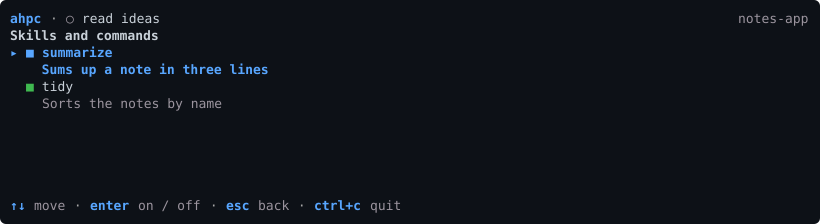
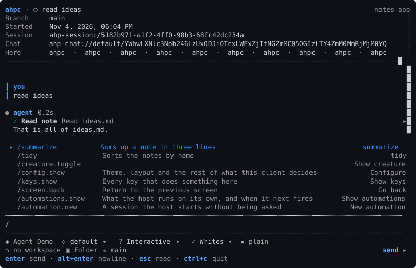

# Customizations

Skills, prompts, agents and MCP servers that plugins and directories give a session. Each can be on or off for a session.

## Screen

In a session:

| Key | |
| --- | --- |
| `k` | Skills and commands: what plugins and directories gave this session |
| `p` | MCP servers: which servers this session has, and whether they answered |

The host sends what the panel lists. It depends on the host, its plugins and the session's workspace, so two hosts list different things.

### The slash menu

`/` in the composer opens the slash menu. The host's skills and commands come first, then ahpc's own commands. Type to narrow the list, and `enter` to pick one. A skill is typed into the message, not run.

## Commands

| Command | | Flags |
| --- | --- | --- |
| `customizations` | What the host offers before any session exists | `--kind k` `--json` |
| `session customizations <uri>` | What one session has | `--json` |
| `session toggle <uri> <id>` | Turn one on | `--off` |

## MCP tools

None.

## Host support

What a session has depends on the host, its plugins, and the session's workspace.
