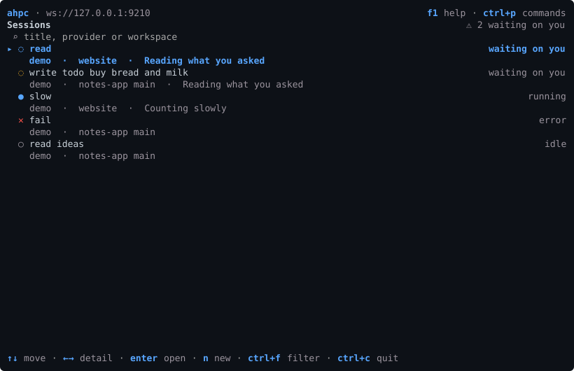

# Sessions

A session is one agent working in one workspace on the host. It has a transcript, a configuration, and the files it changed. Every client connected to the host sees the same sessions.

## Screen



`esc` on a new session opens the session list. See [Moving between screens](../use/SCREEN.md#moving-between-screens).

Each row is a session: its status, agent, workspace, branch, and what it is doing now. Sessions waiting on you are counted at the top.

| Key | |
| --- | --- |
| `enter` | Open the session |
| `n` | New session |
| `f` | Back to the session that was open |
| `ctrl+f` | Filter by title, agent or workspace |
| `right` / `left` | Show or hide the selected session's details |
| `u` | Mark it read |
| `a` | Archive it |
| `x` | Show archived sessions |
| `d`, `delete` | Dispose of it, after you confirm |
| `r` | Refresh |

## Commands

| Command | | Flags |
| --- | --- | --- |
| `session list` | Sessions, newest first | `--archived` `--limit N` `--cursor C` `--json` |
| `session show <uri>` | What the host says about one | `--full` `--json` |
| `session new` | Start one | `--agent P` `--cwd DIR` `--trust` `--set k=v` `--json` |
| `session history <uri>` | Its turns | `--all` `--full` `--json` |
| `session config <uri>` | Its config schema and the values in force | `--json` |
| `session set <uri> <k> <v>` | Change one config value | |
| `session read <uri>` | Mark it read | `--unread` |
| `session archive <uri>` | Archive it | `--undo` |
| `session export <uri>` | The whole session as one document | `--json` `--markdown` |
| `session rm <uri>` | Dispose of it | |

```sh
ahpc session new --agent claude --cwd /work/api --trust
```

`--set` takes keys from the session's config schema, and `session config` lists them. `--trust` is explained in [trusted folders](../start/CONFIGURE.md#trusted-folders).

`session list --limit N` reads one page and ends with `More: --cursor <C>` when there is another. With `--json`, the answer is `{ sessions, nextCursor }`.

## MCP tools

Always served.

<McpTools names="list_sessions,show_session,new_session,dispose_session,session_history" />

## Host support

Every AHP host has sessions. What `session config` offers depends on the host and the agent.
