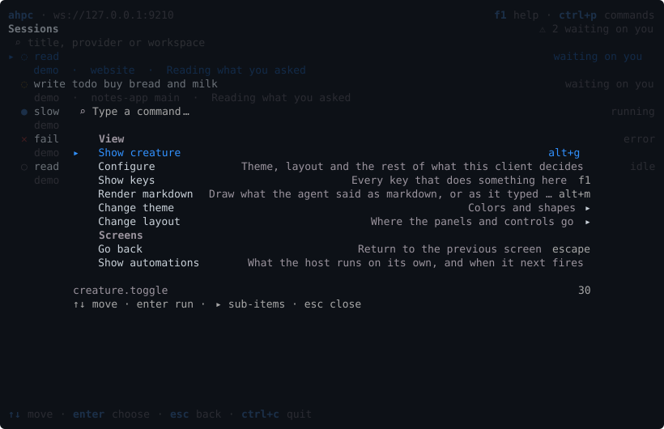

# Keys

`ctrl+p` opens the command palette. It lists every command that works where you are, with its key. Type to filter, `enter` runs a command, and `▸` marks one with more choices.

`f1` lists every key that works where you are.

## Every screen

| Key | |
| --- | --- |
| `ctrl+p` | Command palette |
| `f1` | Every key that works where you are |
| `ctrl+n` | New session |
| `ctrl+r` | Refresh |
| `alt+t` | Theme |
| `alt+m` | Markdown on or off |
| `esc` | Go back one screen |
| `ctrl+c` | Cancel the running turn, or quit |

## Each screen

Each screen has keys of its own, and its last row names the main ones.

| Screen | Its keys |
| --- | --- |
| New session | [New session](NEW-SESSION.md#keys) |
| Session list | [Sessions](../subjects/SESSIONS.md#screen) |
| Session | [Session](SESSION.md#its-screens), and [editing a message](SESSION.md#editing-a-message) |
| Turns | [Turns](../subjects/TURNS.md#screen) |
| Changes | [Changes](../subjects/CHANGES.md#screen) |
| Terminals | [Terminals](../subjects/TERMINALS.md#screen) |
| Automations | [Automations](../subjects/AUTOMATIONS.md#screen) |

To change a key, see [Keys](../start/CONFIGURE.md#keys) in Configure.
