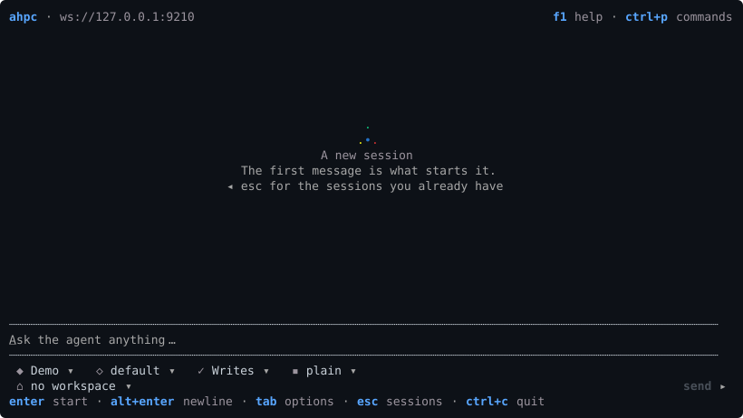

# New session

`ahpc` opens on a new session, and `ctrl+n` opens one from anywhere.

Before the first message, a new session asks for the agent, the model and its options, the permission mode and the workspace. The questions come from the host, so options ahpc does not know still get a chip. See [Agents](../subjects/AGENTS.md).

The workspace chip opens a folder dialog over the host's own directories. `Workspace path` in the palette takes a typed path instead.

The first message starts the session, and the screen becomes [the session](SESSION.md).

## Keys

| Key | |
| --- | --- |
| `enter` | Send |
| `alt+enter` | Newline |
| `tab` | Move through the option rows |
| `/` | Slash commands, from the host and from ahpc. `/config` opens the settings |
| `@` | Complete a file path on the host |
| `ctrl+g` | Edit the message in `$VISUAL` or `$EDITOR` |
| `esc` | Close the menu, leave the field, then go to the session list |

The composer takes the [editing keys](SESSION.md#editing-a-message) too.
