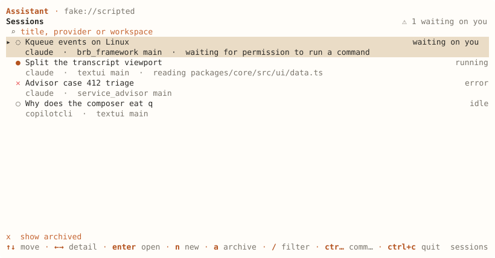
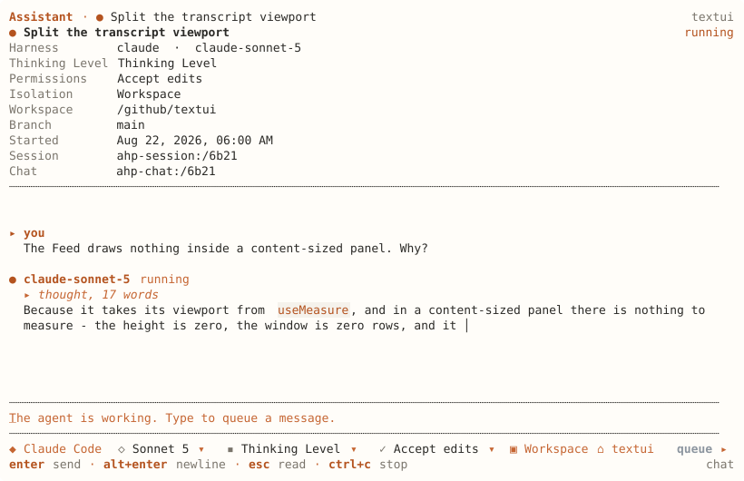
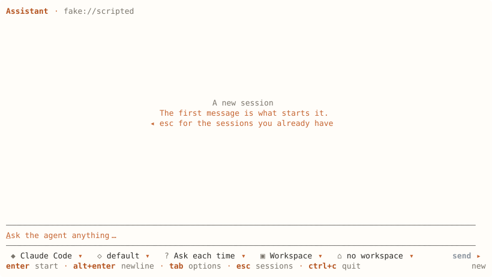

# Screen

`ahpc` with no command opens the screen.

```sh
ahpc --host ws://127.0.0.1:9187
```

| Flag | |
| --- | --- |
| `--session <uri>` | Open on this session. A session URI or an `agent-host-session://` link |
| `--path <dir>` | The workspace a new session starts in |
| `--trust` | Trust `--path` for this run. See [trusted folders](../start/CONFIGURE.md#trusted-folders) |
| `--theme <id>` | The theme to open on |
| `--lang <code>` | `en`, `pt-br` or `es` |
| `--publish <dir>` | Share a folder with the host. See [Resources](../subjects/RESOURCES.md#publish-a-folder-to-the-host) |

## The session list



Each row is a session: its status, agent, workspace, branch, and what it is doing now. Sessions waiting on you are counted at the top.

- `ctrl+f` filters by title, agent or workspace.
- `x` shows the archived sessions.
- `ctrl+n` starts a new session.

## A session



The header shows the model, thinking level, permission mode, workspace and branch, as the host reports them.

`ctrl+f` finds text in the conversation. `enter` or `down` goes to the next match, `up` to the one before.

When a tool call is waiting, `a` approves it, `d` denies it, and `1` to `9` pick an offered option. When the agent asks a question, `tab` moves between fields, `space` selects and `enter` sends. See [Turns](../subjects/TURNS.md).

From a session, one key opens each of its screens:

| Key | Screen |
| --- | --- |
| `c` | [Changes](../subjects/CHANGES.md) |
| `f` | [Files](../subjects/RESOURCES.md) |
| `k` | [Skills and commands](../subjects/CUSTOMIZATIONS.md) |
| `p` | [MCP servers](../subjects/CUSTOMIZATIONS.md) |
| `u` | [Usage](../subjects/TELEMETRY.md#usage) |
| `s` | Session settings |
| `t` | Stop the turn |
| `l` | Follow an `agent-host-session://` link in the conversation |

## A new session



Before the first message, a new session asks for the agent, the model and its options, the permission mode and the workspace. The questions come from the host, so options ahpc does not know still get a chip.

The workspace chip opens a folder dialog over the host's own directories. `Workspace path` in the palette takes a typed path instead.

## Keys

| Key | |
| --- | --- |
| `enter` | Send |
| `alt+enter` | Newline |
| `tab` | Move through the option rows |
| `esc` | Close the menu, leave the field, then go back |
| `/` | Slash commands, from the host and from ahpc. `/config` opens the settings |
| `@` | Complete a file path on the host |
| `ctrl+g` | Edit the message in `$VISUAL` or `$EDITOR` |
| `ctrl+p` | Command palette |
| `f1` | Every key that works where you are |
| `ctrl+f` | Filter the session list, or find in the conversation |
| `ctrl+n` | New session |
| `ctrl+r` | Refresh |
| `alt+t` | Theme |
| `alt+m` | Markdown on or off |
| `ctrl+c` | Cancel the running turn, or quit |

Editing in the composer follows readline:

| Key | |
| --- | --- |
| `ctrl+a` / `ctrl+e` | Start or end of the line |
| `ctrl+k` / `ctrl+u` | Delete to the end, or to the start |
| `ctrl+w`, `alt+backspace` | Delete the word before the caret |
| `alt+d` | Delete the word after it |
| `ctrl+z` / `alt+z` | Undo, redo |
| `ctrl+←` / `ctrl+→` | Move a word at a time |

Undo takes back a word, not a character.

To change a key, see [Keys](../start/CONFIGURE.md#keys).
