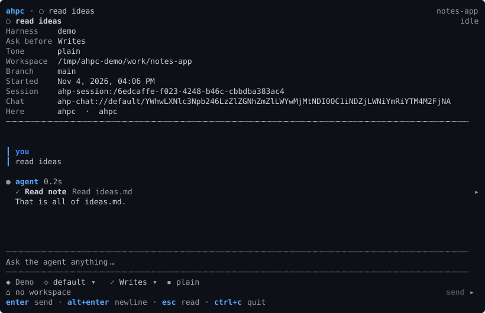
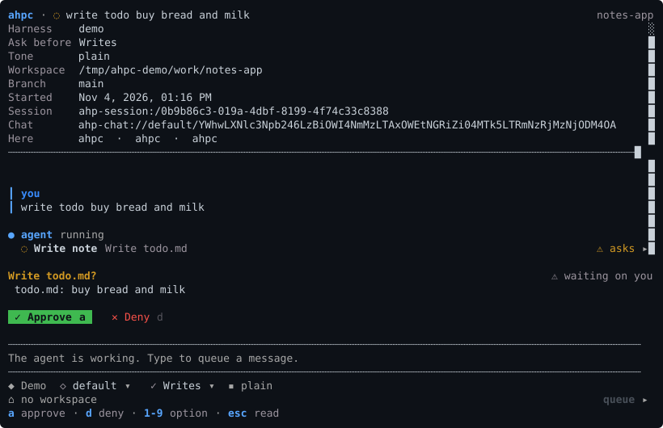

# Session

A session shows its transcript, and the composer for the next message.

The header shows the model, thinking level, permission mode, workspace and branch, as the host reports them.

`ctrl+f` finds text in the conversation. `enter` or `down` goes to the next match, `up` to the one before.

When a tool call is waiting, `a` approves it, `d` denies it, and `1` to `9` pick an offered option. When the agent asks a question, `tab` moves between fields, `space` selects and `enter` sends. See [Turns](../subjects/TURNS.md).

The composer has the keys of [a new session](NEW-SESSION.md#keys). While a turn runs, `enter` queues the message.

## Its screens

The composer takes letters as text. `esc` leaves the composer, and then one key opens each screen of the session:

| Key | Screen |
| --- | --- |
| `c` | [Changes](../subjects/CHANGES.md) |
| `f` | [Files](../subjects/RESOURCES.md) |
| `k` | [Skills and commands](../subjects/CUSTOMIZATIONS.md) |
| `p` | [MCP servers](../subjects/CUSTOMIZATIONS.md) |
| `u` | [Usage](../subjects/TELEMETRY.md#usage) |
| `s` | Session settings |
| `t` | Stop the turn |
| `m` | Markdown on or off |
| `l` | Follow an `agent-host-session://` link in the conversation |

## Editing a message

Editing in the composer follows readline:

| Key | |
| --- | --- |
| `ctrl+a` / `ctrl+e` | Start or end of the line |
| `ctrl+k` / `ctrl+u` | Delete to the end, or to the start |
| `ctrl+w`, `alt+backspace` | Delete the word before the caret |
| `alt+d` | Delete the word after it |
| `ctrl+z` / `alt+z` | Undo, redo |
| `ctrl+←` / `ctrl+→` | Move a word at a time |

Undo takes back a word, not a character.
